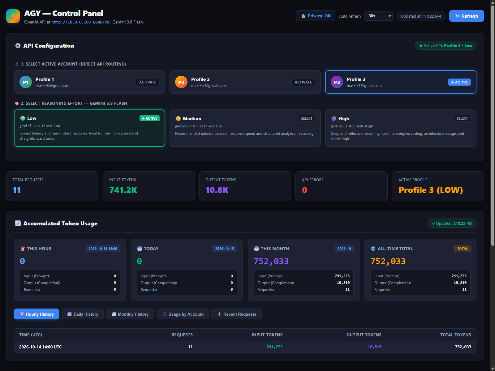
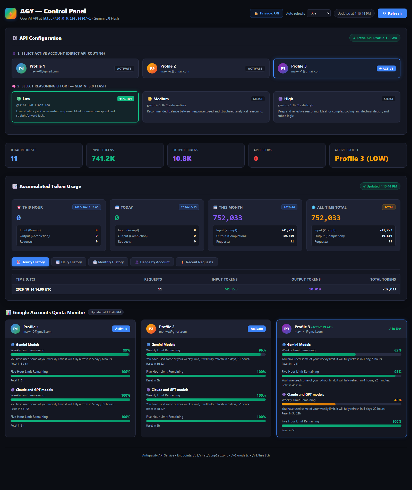
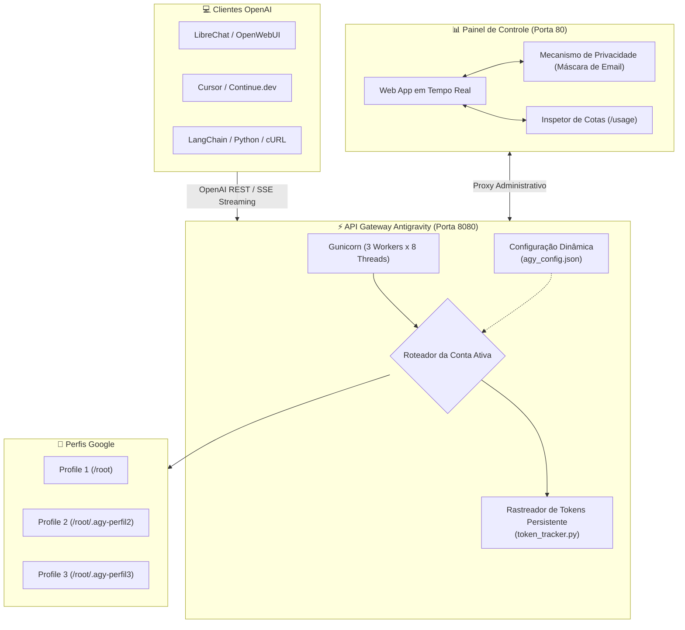

<div align="center">

# ⚡ Antigravity API & Dashboard (v2.0)
### *Gateway de Alta Performance Compatível com OpenAI para Gemini 3.8 Flash com Contador de Tokens em Tempo Real e Monitor de Cotas Google*

[](LICENSE)
[](https://github.com/marceloasl99/antigravity-api-dashboard/releases)
[](https://python.org)
[](https://platform.openai.com/docs/api-reference)

<p align="center">
  <a href="#-visão-geral">Visão Geral</a> •
  <a href="#-novidades-da-versão-20">Novidades da v2.0</a> •
  <a href="#-fotos-do-dashboard">Fotos do Dashboard</a> •
  <a href="#-arquitetura">Arquitetura</a> •
  <a href="#-instalação-rápida">Instalação</a> •
  <a href="#-configuração-multi-contas">Multi-Contas</a> •
  <a href="#-referência-da-api">Referência da API</a> •
  <a href="#-histórico-de-versões">Histórico de Versões</a>
</p>

---

</div>

## 📖 Visão Geral

O **Antigravity API & Dashboard** transforma o **Antigravity CLI (`agy`)** do Google em uma API REST de alta performance **100% compatível com a especificação da OpenAI**. Na versão 2.0, o foco é a execução dedicada do **Gemini 3.8 Flash** com seleção interativa de esforço de raciocínio, contabilização persistente de tokens em tempo real entre múltiplos workers Gunicorn, e monitoramento em tempo real das cotas das contas Google.

> 🔒 **100% Privado e Seguro**: Executado inteiramente em sua infraestrutura local. Possui **Modo de Privacidade** integrado ativado por padrão para ocultar emails e informações sensíveis.

---

## 🚀 Novidades da Versão 2.0

| Recurso | Versão 1.0 (Legada) | Versão 2.0 (Atual) |
| :--- | :--- | :--- |
| **Modelo Especializado** | Roteamento genérico de múltiplos modelos | **Gemini 3.8 Flash Exclusivo** com controle de raciocínio (`Low`, `Medium`, `High`) |
| **Roteamento de Contas** | Round-robin automático | **Roteamento Dedicado Direto**: Escolha no painel web qual conta responde pelas chamadas da API sem disputas ou concorrência |
| **Controle de Tokens** | Contador temporário em memória | **Módulo Persistente de Tokens (`token_tracker.py`)** com travas de arquivo `fcntl` para Gunicorn multi-worker |
| **Histórico Analítico** | Inexistente | Tabelas detalhadas por **Hora (histórico de 7 dias)**, **Dia**, **Mês**, **Por Conta** e **Últimas Requisições** |
| **Privacidade** | Emails exibidos abertamente | **Modo de Privacidade (`🔒 Privacy: ON`)** que mascara emails automaticamente |
| **Compatibilidade OpenAI** | Básica | **Streaming SSE 100% Confiável**: Garante chunks e respostas não vazias (elimina erros de `EMPTY_RESPONSE`) |
| **Arquitetura de Workers** | 7 workers síncronos | **Gunicorn `gthread`**: 3 workers x 8 threads (24 requisições concorrentes não bloqueantes) |
| **Idioma da Interface** | Português | **Painel de Controle 100% em Inglês** com atualização automática configurável |

---

## 📸 Fotos do Dashboard

### 🎛️ Painel de Controle e Contabilização de Tokens (v2.0)


### 📊 Visão Completa: Configurações, Tokens e Monitor de Cotas Google


---

## 🏛️ Arquitetura



---

## 🛠️ Instalação Rápida

### 1. Dependências do Sistema
```bash
sudo apt-get update -y
sudo apt-get install -y python3 python3-pip python3-flask python3-flask-cors gunicorn curl
```

### 2. Instalar Antigravity CLI
```bash
curl -L https://antigravity.google/install.sh | bash
export PATH="$HOME/.local/bin:$PATH"
```

### 3. Clonar Repositório
```bash
git clone https://github.com/marceloasl99/antigravity-api-dashboard.git
cd antigravity-api-dashboard
pip install -r requirements.txt
```

---

## 🔐 Configuração Multi-Contas

Para autenticar as contas Google em pastas isoladas:

```bash
# Conta 1 (Principal)
agy auth login

# Conta 2
mkdir -p /root/.agy-perfil2
HOME=/root/.agy-perfil2 /root/.local/bin/agy auth login

# Conta 3
mkdir -p /root/.agy-perfil3
HOME=/root/.agy-perfil3 /root/.local/bin/agy auth login
```

Copie o arquivo de exemplo de perfis:
```bash
cp profiles.example.json profiles.json
```

---

## 🔄 Configuração do Serviço (Systemd)

Para manter a API e o Dashboard rodando como serviços em segundo plano:

```bash
sudo cp systemd/agy-api.service /etc/systemd/system/
sudo cp systemd/agy-dashboard.service /etc/systemd/system/

sudo systemctl daemon-reload
sudo systemctl enable --now agy-api.service
sudo systemctl enable --now agy-dashboard.service
```

---

## 📡 Referência da API

Base URL: `http://<ip-do-servidor>:8080/v1`

- `POST /v1/chat/completions`: Endpoint principal de chat (suporta `stream: true`).
- `GET /v1/models`: Lista os modelos disponíveis (Gemini 3.8 Flash Low, Medium, High).
- `GET /v1/config` e `POST /v1/config`: Consulta e alteração da conta ativa ou nível de raciocínio.
- `GET /v1/tokens/usage`: Consulta o consumo acumulado de tokens.
- `GET /v1/profiles/usage`: Consulta cotas Google em tempo real.
- `GET /v1/health`: Verificação de integridade da API.

---

## 📜 Histórico de Versões

### Versão 2.0.0 (Atual)
- Roteamento dedicado da conta ativa direto no painel web.
- Exclusividade Gemini 3.8 Flash com controle de esforço (`Low`, `Medium`, `High`).
- Rastreador persistente de tokens (`token_tracker.py`) com bloqueio atômico `fcntl`.
- Painel de controle totalmente em inglês.
- Modo de privacidade com mascaramento de emails sensíveis por padrão.
- Gunicorn com `gthread` (3 workers x 8 threads = 24 conexões simultâneas).

### Versão 1.0.0 (Legada)
- Versão inicial com suporte a round-robin automático entre contas.
- Roteamento por prefixo (`p1/`, `p2/`, `p3/`).
- Dashboard inicial em português com monitor de cotas.

---

## 📄 Licença

Distribuído sob a licença **MIT**. Veja [`LICENSE`](LICENSE) para mais detalhes.
