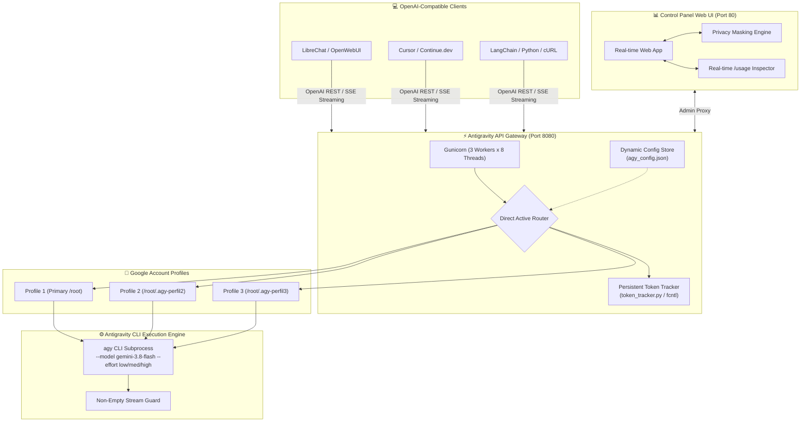

<div align="center">

# ⚡ Antigravity API & Dashboard (v2.0)
### *High-Throughput OpenAI-Compatible Gateway for Gemini 3.8 Flash with Real-Time Token Tracking & Google Quota Monitoring*

[](LICENSE)
[](https://github.com/marceloasl99/antigravity-api-dashboard/releases)
[](https://python.org)
[](https://platform.openai.com/docs/api-reference)
[](https://palletsprojects.com/p/flask/)
[](https://github.com/marceloasl99/antigravity-api-dashboard/pulls)

<p align="center">
  <a href="#-overview">Overview</a> •
  <a href="#-whats-new-in-v20">What's New in v2.0</a> •
  <a href="#-dashboard-preview">Dashboard Preview</a> •
  <a href="#-architecture">Architecture</a> •
  <a href="#-quickstart">Quickstart</a> •
  <a href="#-multi-account-setup">Multi-Account Setup</a> •
  <a href="#-api-reference">API Reference</a> •
  <a href="#-integrations">Integrations</a> •
  <a href="#-version-history">Version History</a> •
  <a href="#-security">Security</a>
</p>

---

</div>

## 📖 Overview

**Antigravity API & Dashboard** converts Google's **Antigravity CLI (`agy`)** into a high-performance, self-hosted **OpenAI-compatible REST API gateway**. It empowers you to run **Gemini 3.8 Flash** with selectable reasoning effort levels, monitor real-time token consumption across multi-worker environments, switch active Google accounts with zero downtime, and inspect your Google account quotas through a modern web control panel.

Designed for self-hosters and power users integrating Gemini into tools like **LibreChat**, **OpenWebUI**, **LiteLLM**, **Cursor**, **Continue.dev**, and **LangChain**.

> 🔒 **100% Private & Self-Hosted**: Runs entirely in your private homelab or container (Proxmox LXC, Docker, Ubuntu/Debian). Built-in Privacy Mode protects and masks sensitive account credentials and emails.

---

## 🚀 What's New in v2.0

Version 2.0 represents a major architectural upgrade over Version 1.0:

| Feature | Version 1.0 (Legacy) | Version 2.0 (Current) |
| :--- | :--- | :--- |
| **Model Specialization** | Generic multi-model routing | **Gemini 3.8 Flash Exclusive** with dedicated reasoning effort control (`Low`, `Medium`, `High`) |
| **Account Routing** | Random round-robin rotation | **Direct Dedicated Routing**: Instant one-click selection of active account in UI without round-robin race conditions |
| **Token Tracking** | Transient in-memory request counter | **Persistent Multi-Worker Token Tracker (`token_tracker.py`)** with `fcntl` file-locking across Gunicorn workers |
| **Historical Analytics** | None | **Granular Breakdowns**: Hourly history (7-day rolling), Daily history, Monthly history, Usage by Account, and Recent Requests log |
| **Privacy Protection** | Plain text email display | **Built-in Privacy Mode (`🔒 Privacy Mode`)**: Enabled by default, masks sensitive Google account emails |
| **OpenAI Compatibility** | Basic completions | **100% Reliable SSE Streaming**: Guaranteed non-empty chunks and complete responses (eliminates `EMPTY_RESPONSE`) |
| **Concurrency Engine** | 7 sync workers | **Gunicorn `gthread`**: 3 workers x 8 threads (24 concurrent streaming connections) with keep-alive |
| **User Interface** | Portuguese dashboard | **100% English Modern Control Panel** with responsive auto-refresh intervals |

---

## 📸 Dashboard Preview

### 🎛️ Version 2.0 Control Panel & Token Usage


### 📊 Complete View: API Configuration, Accumulated Tokens & Quota Telemetry


---

## 🏛️ Architecture



---

## ⚡ Key Features

- **OpenAI v1 Compatibility**: Supports `/v1/chat/completions` (streaming & non-streaming), `/v1/responses`, `/v1/completions`, `/v1/models`, `/v1/config`, `/v1/tokens/usage`, `/v1/health`.
- **Gemini 3.8 Flash Reasoning Effort Selection**:
  - `🟢 Low` (`gemini-3.8-flash-low`): Near-instant response time, minimal latency for high-throughput agents.
  - `🟡 Medium` (`gemini-3.8-flash-medium`): Optimal balance between speed and structured analytical reasoning.
  - `🟣 High` (`gemini-3.8-flash-high`): Deep and reflective reasoning for complex code architectures and logic.
- **Dedicated Profile Selection**: Directly assign which Google account serves API traffic. Switch instantly from the web interface without restarting services.
- **Real-Time Token Usage Tracking**:
  - Automatically records prompt and completion tokens.
  - Tabbed metrics: **Hourly**, **Daily**, **Monthly**, **By Account**, and **Recent Requests**.
  - Safe across multi-process Gunicorn workers via POSIX file locking (`fcntl`).
- **Real-Time Google Quota Telemetry**: Reads live `/usage` statistics directly from the AGY CLI, displaying weekly and 5-hour limit percentages and reset countdowns.
- **Privacy Mode**: Toggle privacy with one click (`🔒 Privacy Mode: ON`) to mask sensitive email addresses (`ma••••0@gmail.com`) for public demos or screenshots.

---

## 🚀 Quickstart

### 1. Prerequisites
Ubuntu/Debian or Proxmox LXC container with Python 3.10+:

```bash
sudo apt-get update -y
sudo apt-get install -y python3 python3-pip python3-flask python3-flask-cors gunicorn curl
```

### 2. Install the Antigravity CLI
Install the official Google Antigravity CLI:

```bash
curl -L https://antigravity.google/install.sh | bash
export PATH="$HOME/.local/bin:$PATH"
```

### 3. Clone Repository & Install Dependencies
```bash
git clone https://github.com/marceloasl99/antigravity-api-dashboard.git
cd antigravity-api-dashboard
pip install -r requirements.txt
```

---

## 🔐 Multi-Account Setup

Antigravity stores OAuth tokens inside `$HOME/.gemini/antigravity-cli/`. To run multiple isolated Google accounts simultaneously:

### Step 1: Authenticate Profile 1 (Default)
```bash
agy auth login
```

### Step 2: Authenticate Profile 2
```bash
mkdir -p /root/.agy-perfil2
HOME=/root/.agy-perfil2 /root/.local/bin/agy auth login
```

### Step 3: Authenticate Profile 3
```bash
mkdir -p /root/.agy-perfil3
HOME=/root/.agy-perfil3 /root/.local/bin/agy auth login
```

### Step 4: Configure Profiles
Create your local `profiles.json` (ignored by Git):
```bash
cp profiles.example.json profiles.json
```
```json
[
  {
    "id": "p1",
    "name": "Profile 1",
    "email": "your-account-1@gmail.com",
    "home": "/root",
    "concurrency": 4
  },
  {
    "id": "p2",
    "name": "Profile 2",
    "email": "your-account-2@gmail.com",
    "home": "/root/.agy-perfil2",
    "concurrency": 4
  },
  {
    "id": "p3",
    "name": "Profile 3",
    "email": "your-account-3@gmail.com",
    "home": "/root/.agy-perfil3",
    "concurrency": 4
  }
]
```

---

## 🔄 Systemd Service Setup

To keep the API and Dashboard running 24/7 as background daemons:

```bash
# 1. Copy service units
sudo cp systemd/agy-api.service /etc/systemd/system/
sudo cp systemd/agy-dashboard.service /etc/systemd/system/

# 2. Reload and enable services
sudo systemctl daemon-reload
sudo systemctl enable --now agy-api.service
sudo systemctl enable --now agy-dashboard.service

# 3. Verify status
sudo systemctl status agy-api.service
sudo systemctl status agy-dashboard.service
```

---

## 📡 API Reference

Base URL: `http://<server-ip>:8080/v1`

### Endpoints

| Method | Endpoint | Description |
| :--- | :--- | :--- |
| `POST` | `/v1/chat/completions` | Standard OpenAI chat completion (streaming supported via `stream: true`) |
| `POST` | `/v1/responses` | OpenAI compatibility alias |
| `POST` | `/v1/completions` | Legacy completions endpoint |
| `GET` | `/v1/models` | List available Gemini 3.8 Flash model configurations |
| `GET` | `/v1/config` | Retrieve current active profile and reasoning effort |
| `POST` | `/v1/config` | Dynamically update active profile or reasoning effort |
| `GET` | `/v1/tokens/usage` | Retrieve accumulated token usage summary |
| `GET` | `/v1/profiles` | List configured accounts and real-time statistics |
| `GET` | `/v1/profiles/usage` | Fetch real-time Google account quota consumption |
| `GET` | `/v1/health` | Service health status |

### Dynamic Configuration via API

Switch the active account or reasoning effort programmatically:

```bash
# Switch to Profile 2
curl -X POST http://<server-ip>:8080/v1/config \
  -H "Content-Type: application/json" \
  -d '{"active_profile": "p2"}'

# Switch reasoning effort to High
curl -X POST http://<server-ip>:8080/v1/config \
  -H "Content-Type: application/json" \
  -d '{"active_effort": "high"}'
```

---

## 🔌 Integrations

### Python OpenAI SDK
```python
from openai import OpenAI

client = OpenAI(
    base_url="http://10.0.0.108:8080/v1",  # Replace with your server IP
    api_key="none"
)

# Streaming completion with Gemini 3.8 Flash
stream = client.chat.completions.create(
    model="gemini-3.8-flash-low",
    messages=[
        {"role": "system", "content": "You are a concise engineering assistant."},
        {"role": "user", "content": "Summarize the key advantages of event-driven architecture."}
    ],
    stream=True
)

for chunk in stream:
    if chunk.choices[0].delta.content:
        print(chunk.choices[0].delta.content, end="", flush=True)
```

### cURL Streaming
```bash
curl -N -X POST http://localhost:8080/v1/chat/completions \
  -H "Content-Type: application/json" \
  -d '{
    "model": "gemini-3.8-flash-medium",
    "stream": true,
    "messages": [
      {"role": "user", "content": "Write a Python script to sort a list of dictionaries by key."}
    ]
  }'
```

### LibreChat / OpenWebUI Configuration
```yaml
endpoints:
  custom:
    - name: "Antigravity Gateway (v2.0)"
      apiKey: "local"
      baseURL: "http://<YOUR_SERVER_IP>:8080/v1"
      models:
        default: ["gemini-3.8-flash-low", "gemini-3.8-flash-medium", "gemini-3.8-flash-high"]
        fetch: true
```

---

## 📜 Version History

### Version 2.0.0 (Current)
- **Gemini 3.8 Flash Exclusive**: Fine-tuned execution parameters with selectable effort (`low`, `medium`, `high`).
- **Direct Account Routing**: Active account selector replacing unpredictable round-robin routing.
- **Persistent Token Tracker**: New `token_tracker.py` with multi-worker atomic locking (`fcntl`), hourly/daily/monthly/profile tables.
- **100% English Web Dashboard**: Full internationalization of the web control panel.
- **Privacy Mode**: Built-in privacy toggle to mask personal emails in the UI.
- **Production Gunicorn `gthread`**: Upgraded to 3 workers x 8 threads (24 concurrent streaming requests).
- **Non-Empty Stream Guarantee**: Eliminates empty chunk errors across all OpenAI client libraries.

### Version 1.0.0 (Legacy)
- Initial release featuring multi-account round-robin load balancing.
- Basic prefix routing (`p1/`, `p2/`, `p3/`).
- Initial Portuguese web dashboard monitoring Google quotas.
- Sync Gunicorn worker architecture.

---

## 🛡️ Security & Privacy

- **Strict Git Hygiene**: `.gitignore` ensures that `profiles.json`, `.env`, OAuth tokens (`.gemini/`, `.agy*`), and runtime logs are never committed.
- **Sensitive Data Masking**: All profile emails are masked by default in the UI to prevent accidental data leaks during screen sharing or screenshots.
- **Direct Connection**: No external servers, middleman APIs, or telemetry. All requests communicate directly between your server and Google AI endpoints.

---

## 📄 License

Distributed under the **MIT License**. See [`LICENSE`](LICENSE) for details.

<div align="center">
  <sub>Built with ❤️ for homelabs, developers, and AI enthusiasts.</sub>
</div>
